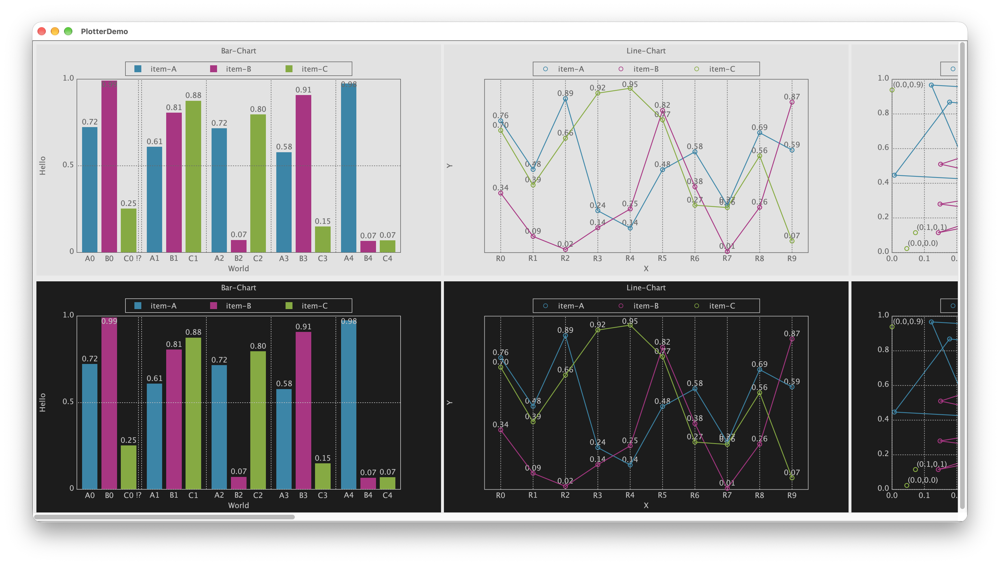
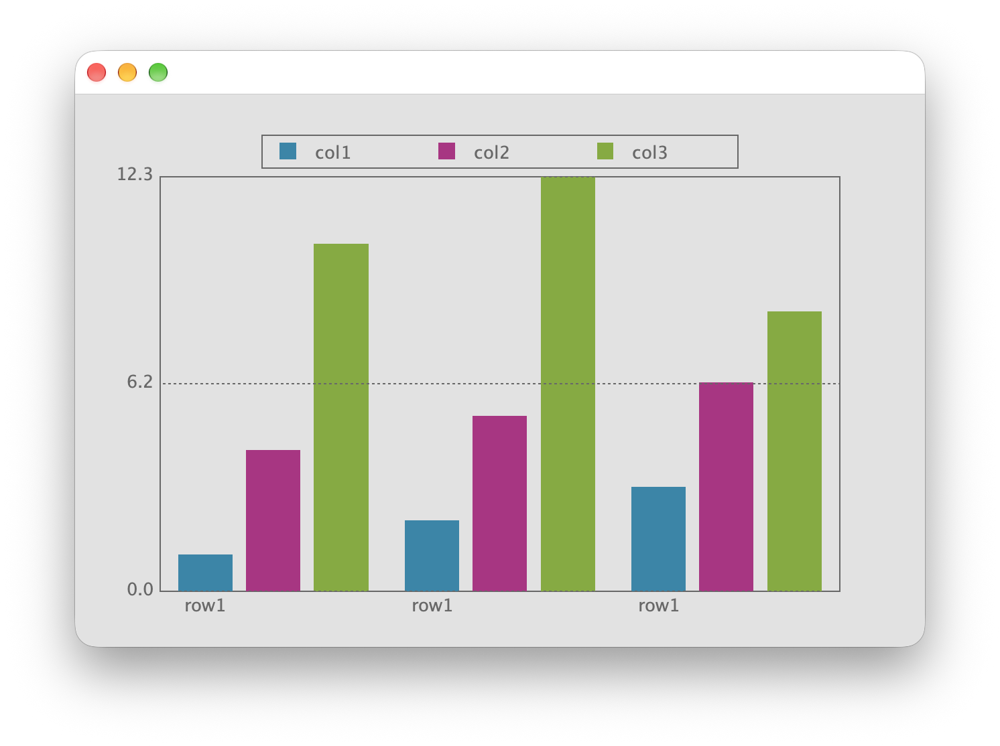
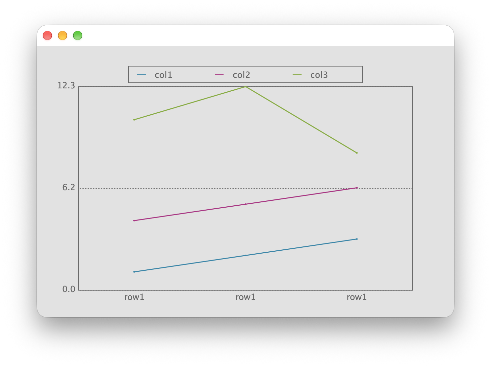

# desktop-plotter

A simple 2D chart drawing library for Java.

## License

[Apache License v2](LICENSE.txt)

## Building from source 


[GitHub Project Page](https://github.com/ppp-kohe/desktop-plotter.git)


The project uses [apache-maven](http://maven.apache.org) and depends on a recent version of Java (JDK 25-). 

```bash
git clone https://github.com/ppp-kohe/desktop-plotter.git
cd desktop-plotter

./mvnw package
  # the command will generate target/desktop-plotter-1.0.jar

./mvnw install
  # the command makes the built library available locally to other projects. 

./mvnw javadoc:javadoc
  # the command generates javadoc API documentation to target/reports/apidocs/index.html
```

## Quick tutorial

The library can be used via `jshell` REPL.

```java
/env -class-path target/desktop-plotter-1.0.jar

import  org.autogui.plot.*;

PlotterDemo.main(null) 
```

The above jshell instructions will show the window of demo outputs like the following image.



The code of the class [`PlotterDemo.java`](https://github.com/ppp-kohe/desktop-plotter/blob/main/src/main/java/org/autogui/plot/PlotterDemo.java) has examples of usage of the library.

The library takes a table as inputs. The class `PlotterMatrix` is a convenient gateway of the library.

An input table takes the following form:
```
           ,  col1_label,     col2_label,     col3_label, ...
 row1_label,  row1_col1_data, row1_col2_data, row1_col3_data, ...
 row2_label,  row2_col1_data, row2_col2_data, row2_col3_data, ...
 row3_label,  row3_col1_data, row3_col2_data, row3_col3_data, ...
 ...
```

The top row and column are headers for names of data series and names of data groups.

```java
Object[][] data = {
    {"",    "col1", "col2", "col3"},
    {"row1", "1.1", "4.2", "10.3"},
    {"row1", "2.1", "5.2", "12.3"},
    {"row1", "3.1", "6.2", "8.3"}
};
var p = PlotterForMatrix.create();
p.setData(data, true, true);
p.displayPlot();
```

The above code will show a window of a bar chart like the following image.

* The array data has row and column labels.
    * Each data point is a number in string: you can write a `double` or `float` number directly.
* The `setData(data, true, true)` takes 2 flags indicating that the top row is labels and also the top column is labels.
    * The simple `setData(data)` method does not specify the labels. So data will be numbers of the matrix.
* The `displayPlot` call creates an output window. 



```java
p.setMode(PlotterForMatrix.PlotMode.Line);
p.displayPlot();
```

Following the above calls, another window will be shown as a line chart of the same data.



To save the plotting result as an image file, you can use the `savePlot(Path)` method like the following. 

```java
import java.nio.file.*;
p.savePlot(Paths.get("output.png"))
```

There are other destination methods for plotting. 

* `BufferedImage plot()`
* `plot(Graphics2D)` or `print(Graphics2D)` (suitable for printing: `print()` showing a printing dialog)

The `PlotterForMatrix` class has various setter methods for configuring plotting output.

* `setData(data...)` , `setDataOfSingleColumn(data...)`
* `setHeight(h)`, `setWidth(w)`, `setSize(w,h)` : change the area size
* `setLogarithm(boolean)` : change to log-scaling y values
* `setMaxValue(v)`, `setMinValue(v)` : specifying the maximum or minimum y-value 
* `setMode(Bar, Line, Point, Scatter, or ScatterLine)`
* `setPlotFont(Font)` : specifying the label font
* `setPlotIndexColor((col,maxCols) -> Color)` : specifying the coloring function
* `setPlotPaintForDark()`, `setPlotPaintForLight()`, `setPlotPaintForPrint()` : specifying background and font colors by theme. `setPlotAreaBackground(Color)` and `setPlotAreaForeground(Color)` can specify manually. 
* `setPlot...(...)` : there are some methods for specifying precise graphics settings 
* `setTitle(String)` : specifying the title string
* `setXAxisLabel(String)`, `setYAxisLabel(String)` : specifying labels
* `setGridLine(boolean)` : specifying showing grid lines
* `setValueLabel(boolean)`: change showing labels of values


The `PlotterPane` class is a Swing component showing `PlotterForMatrix`.
It can be used by simply creating a new instance with `new PlotterPane()` and `setPlotter(PlotterForMatrix)`.

### Converting data for plotting

The library has a data collector named `PlotterDataBuilder` in the sub-package `org.autogui.plot.data`.

For guidance, refer to the documentation comments of [the class](https://github.com/ppp-kohe/desktop-plotter/blob/main/src/main/java/org/autogui/plot/data/PlotterDataBuilder.java) and [the test class](https://github.com/ppp-kohe/desktop-plotter/blob/main/src/test/java/org/autogui/plot/test/data/PlotterDataBuilderTest.java) as usage examples. 
